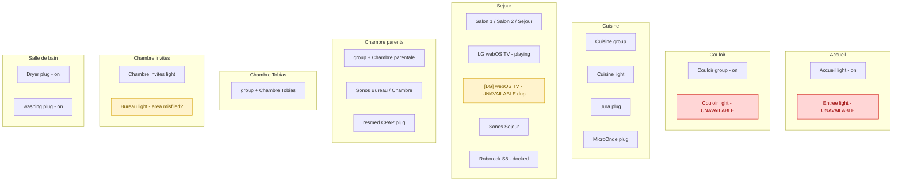

# Home Assistant — Home Map & Cleanup Notes

_Snapshot: 2026-06-21 22:30 CEST. Source: HA Assist live context (names/states/areas only — entity IDs and owning integrations require the registry)._

## Home map by area

## Key insight: most "duplicates" are the Philips Hue pattern

The stock scene names (Concentration, Détente, Lecture, Lumière naturelle, Repos,
Veilleuse…) confirm a Philips Hue setup. Hue exposes **one `light.` group entity per
room** *plus* the individual lights, so nearly every room legitimately shows a pair —
these are **intentional, keep them**:

| Room (area)        | Hue room group (= area name)   | Member / individual light |
|--------------------|--------------------------------|---------------------------|
| Couloir            | `Couloir`                      | `Couloir`                 |
| Cuisine            | `Cuisine`                      | `Cuisine`                 |
| Chambre parents    | `Chambre à coucher parents`    | `Chambre parentale`       |
| Chambre Tobias     | `Chambre à coucher Tobias`     | `Chambre Tobias`          |
| Chambre invités    | `Chambre invités`              | `Bureau`                  |

## The real cleanup list

| # | Item | Type | Action |
|---|------|------|--------|
| 1 | `[LG] webOS TV OLED65C37LA` (unavailable) | Redundant entity from a 2nd integration | Disable the entity (reversible); remove the integration if otherwise unused |
| 2 | `Entrée` light (unavailable) | Real Hue bulb offline — **not** a duplicate | Power-cycle / check Hue mesh |
| 3 | `Couloir` light (unavailable) | Real Hue bulb offline — **not** a duplicate | Power-cycle / check Hue mesh |
| 4 | `Bureau` light filed under area "Chambre à coucher invités" | Possible area mis-assignment | Confirm office ≠ guest room; reassign area if wrong |

**Golden rule:** disable before delete. Deleting an entity an integration still provides
just respawns it — to truly remove, delete the **device** or the **integration**.

## Removed (done)

- `TV-Box 2` (Swisscom set-top box, returned) — 3 stale `media_player` entities removed. ✓

## Still open (parked)

- **Netatmo** integration — OAuth re-auth loops (`invalid_grant` / multiple authorized
  links + HA core bug [#163464](https://github.com/home-assistant/core/issues/163464)).
  Parked by request.

## Audit 2026-10-19 (registry dump via WebSocket API)

Backup of the dump before changes: `~/Downloads/ha-dump-2026-10-19.json`.

Root causes of the "lost information":
- **Hue bridge integrated twice** — native `hue` *and* the Matter bridge (`matter`, 17 devices). Matter created 8 duplicate lights (`light.*_2` / `_3`). Kept Matter for the dimmer-switch events; hid its lights and removed them from Assist.
- **Netatmo re-added ~2026-06-21** — the entity IDs changed from `sensor.weather_station_*` to `sensor.weather_station_2_*`, which orphaned Jan–Jun history. Copied the hourly stats into the new IDs with `recorder/import_statistics`. The old statistic IDs are still there and can be cleared in Developer tools → Statistics.

Applied:
- Matter lights hidden and unexposed; duplicate "Cuisine 3" dashboard tile removed.
- 8 Netatmo sensors: history restored from 2026-01-24.
- Exposed to Assist: 2 persons, `weather.forecast_maison`, 6 plug `*_power` sensors, Montreux and Netatmo pressure/noise/rain/wind sensors.
- Unexposed the 53 Hue scenes. 8 Hue dimmer remotes assigned to rooms. Enabled the `sensor.winbox_internet_box_temps_de_fonctionnement` uptime sensor (a dashboard card was showing it as missing).

Still open:
- Orphaned statistics with no entity: HP Envy ink levels, PSN trophies (`fjacquet_*`) and 2 Brother toner levels. Clear them if those devices or integrations are gone.
- Stale `not_loaded` config entries with no devices: `matter` (01KVNZ) and `smartthings`. Delete them in the UI.
- Room group and bulb share a name (Couloir, Cuisine), so Assist shows 2 of each. Rename the room group (e.g. "Cuisine (pièce)") if voice is ambiguous.
- `Entree` and `Couloir` bulbs are unavailable. That's a hardware/mesh problem, not config.

## Round 2 (2026-10-19): UI additions

- **UPnP**: enabled the 12 Internet-Box traffic/packet sensors (disabled by default).
- **New "Énergie" view**: live power from the 6 plugs, 14-day kWh-per-day bar chart, Electricity Maps carbon intensity and fossil-share gauges, and an Internet throughput section.
- **Accueil**: added a "Départs Montreux → Lausanne" section and a "Batteries & consommables" section (Hue remotes, Netatmo modules, phones, Brother toner).
- **Cluster view**: new "Santé" section backed by 6 REST sensors appended to `/volume1/docker/home-assistant/config/packages/cluster.yaml` (backup: `cluster.yaml.bak-20261019`). The sensors are Prometheus targets down, nodes needing a reboot, failing SMART disks (only disks with `smart_available=1`, because the LXD VM virtual disks report healthy=0), Traefik req/s, Traefik 5xx per hour, and NAS max disk temperature.
- **Restored the dashboards lost on 2026-06-28** (Salon, Cuisine, Tobias) from `/volume1/docker/homeassistant.bak/.storage`. Netatmo IDs were remapped. Dead PSN/HP/Hue-automation tiles and dangerous buttons (NAS shutdown/reboot, plug factory reset/restart/safe mode) were removed.
- No Energy CO₂ card: it needs a grid-consumption source, and there's no grid meter.
- The `http:` trusted_proxies block disappeared from `configuration.yaml` on 2026-09-20. `homeassistant.evlab.ch` still answers 200 through Traefik, so I didn't put it back.

## Round 3 (2026-10-19): Powercalc

- `/volume1/docker/home-assistant/config/packages/powercalc.yaml` (HACS powercalc v1.26.1). Groups:
  - **Homelab**: 5 OptiPlex nodes estimated as `9 W + 0.26 W × CPU %` from the Prometheus REST CPU sensors, plus the DS923+ at a fixed 36 W.
  - **Maison total**: the 6 ESPHome plugs (measured) + Homelab + `all_light` + `all_media_player` + Hue bridge.
  - Manual profiles: LG OLED65C3 (110 W on, 0.5 W standby) and Entrée Hue Enrave (linear 0.4–22 W).
- Accepted the library discoveries for 7 Hue Infuse ceilings, 3 Sonos (One SL ×2, Beam) and the Hue bridge. Ignored the "Hue Bridge – Matter" duplicate.
- Énergie view: total gauge, apexcharts donut breakdown, Homelab per-node tiles, 24 h power history, kWh/day bars.
- Energy dashboard: added `homelab`, `all_light`, `all_media_player` and `hue_bridge` energy as device consumption. They don't overlap the plugs.
- The CPU→W coefficients are estimates. Calibrate them with a plug meter on one node if accuracy matters.

## Round 4 (2026-10-19): dashboard reorganisation

Backup before changes: `/volume1/docker/home-assistant/config/dashboard-backup-20261019/` (copies of `.storage/lovelace*`).

- **Maison** (everyone): Accueil, the room views, Énergie, Vacances.
  - Accueil = chips, "À surveiller" (conditional: Internet down, batteries < 20 %, toner < 15 %, homelab health > 0, CO₂ > 1000), room-group lighting, weather, departures, energy summary, to-do, multiroom, rooms.
  - Every room follows Vue d'ensemble > Éclairage > Ambiances > Climat > Appareils.
- **Infra** (`dashboard-infra`, admin only): Réseau (Internet-Box, Traefik), NAS (DS923+, disks, backups), Cluster, Maintenance (batteries, updates, NAS actions).
- **Kiosks** Salon / Cuisine / Tobias: rebuilt for daily use with no diagnostics. Salon = lights, music/TV, vacuum, climate. Cuisine = lights, Jura/micro-ondes, shopping list, departures. Tobias = lights, scenes, CO₂ gauge with an "aérer" prompt.
- Bugs fixed along the way: the Séjour TV tile pointed at the dead `media_player.lg_webos_tv_oled65c37la_2`; Accueil and Bain showed `*_apparent_power` (VA) instead of W.
- Open: the UPnP config entry has been in `setup_retry` ("Device not discovered") since the 22:05 restart, so all `winbox_internet_box_*` sensors are unavailable.

## Round 5 (2026-10-19): consistency pass

Style rule applied to every view:
- Section order: Éclairage > Ambiances > Climat > Médias > Appareils (+ Aspirateur), each with an icon.
- Lights: mushroom-light-card, 2 columns. The Hue room group comes first, named "Pièce", then the bulbs.
- Appareils: power in W named after the appliance. Switch only for Jura and micro-ondes; never ResMed or the washer/dryer.
- Removed the empty area "Vue d'ensemble" cards. Accueil › Pièces handles navigation, with names matching the view titles.
- Kiosks renamed "Tablette Séjour / Cuisine / Tobias" (URLs unchanged); they reuse the room views' sections.
- Fixed: the "Plan de travail" label was on the Hue room group `light.cuisine_2`; the 24 h temperature chart was under Éclairage on Accueil.

## Round 6 (2026-10-19): HA 2026.10.2

- The user upgraded HA to 2026.10.2; no repairs, all integrations loaded except UPnP (it takes ~8 min to rediscover after every restart).
- Accueil "À surveiller" now uses native `visibility`:
  - One tile per alert, each with a `numeric_state`/`state` visibility condition.
  - The whole section has a `template` visibility (OR of all alerts), so it disappears when nothing needs attention.
- New 2026.10 map works (persons, dark vector tiles). The 3 Netatmo stations (WS2) show up as markers far from home because the Netatmo integration reports public-station coordinates.
